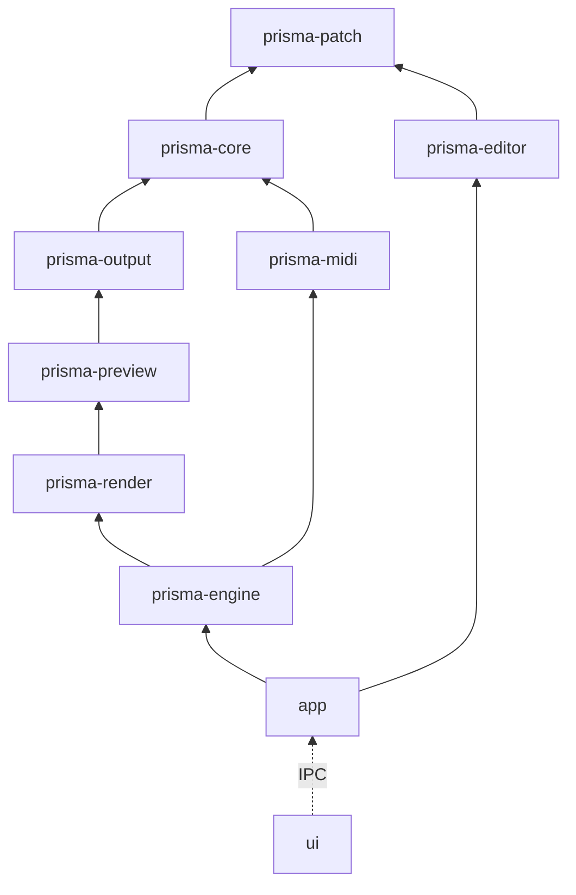
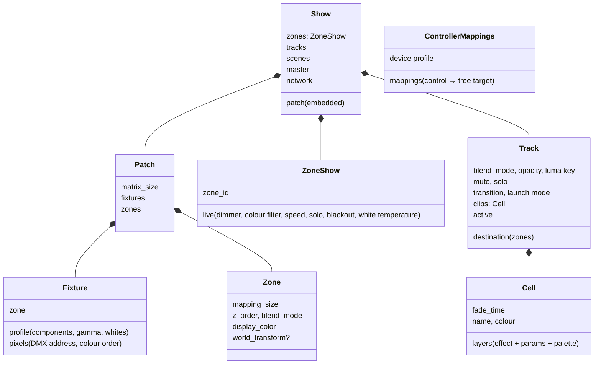
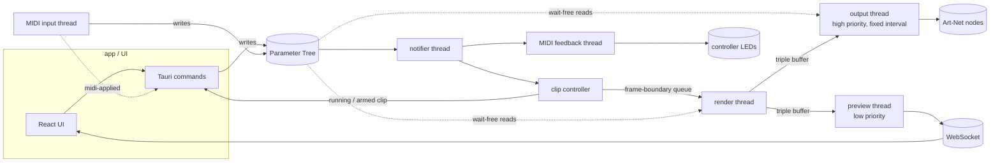
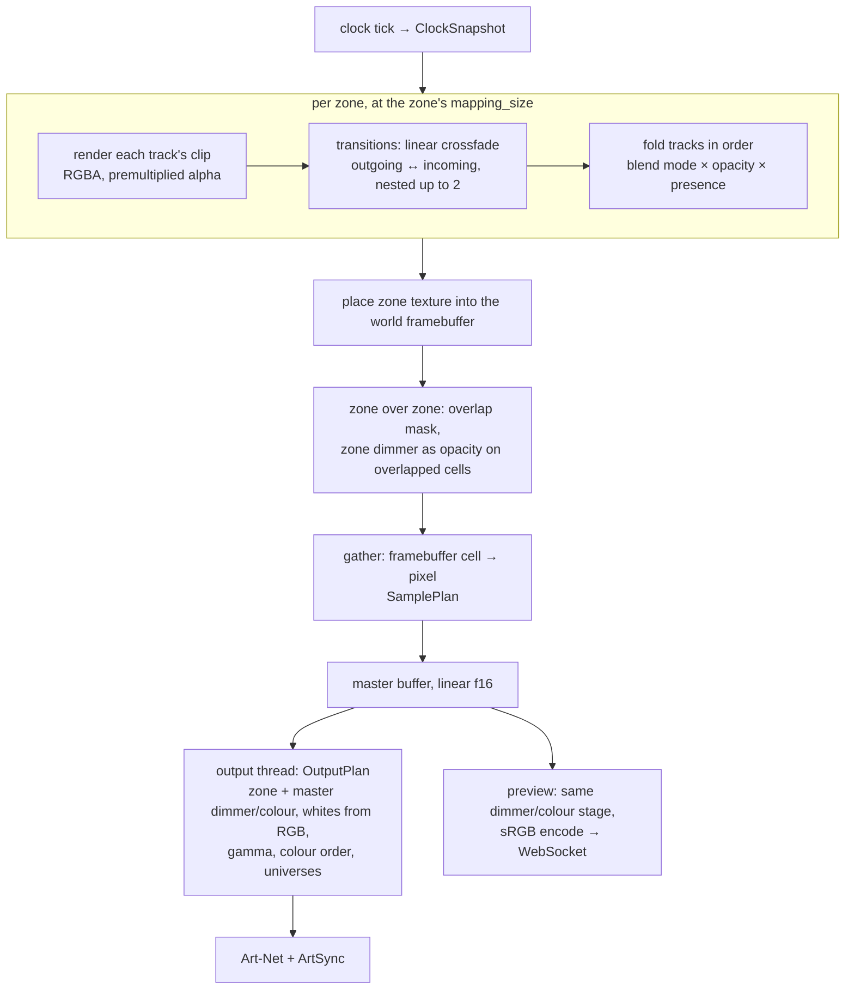
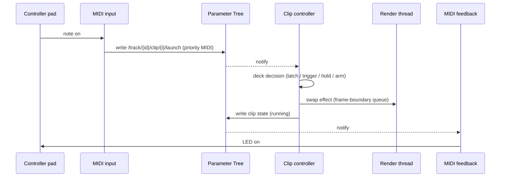

# Architecture

How Prisma is put together: crates, documents, threads, the path of a frame and the path of a
control. Detailed design decisions live in the doc comments of each module; this file is the map.

Scope: the live model with tracks. Zones, patch, output and preview are unchanged by it.

## 1. Crates

Arrows point to what a crate depends on. Dependencies implied by another arrow are left out
(`render` also uses `core`, `patch` and `output` directly).

| Crate | Owns |
|---|---|
| `prisma-patch` | patch model, `PatchIndex` |
| `prisma-core` | clock, Parameter Tree, show model, decks, transitions |
| `prisma-output` | `OutputPlan`, Art-Net, output scheduler, virtual sink |
| `prisma-preview` | master buffer → sRGB → WebSocket |
| `prisma-render` | wgpu, effects, blend, gather |
| `prisma-midi` | mappings, learn, device profiles, LED feedback |
| `prisma-editor` | patch draft, reversible edit ops |
| `prisma-engine` | assembly, threads, show content |
| `prisma-script` | Lua, placeholder |
| `app` | Tauri shell, IPC commands |
| `ui` | React |

Rules:

- `prisma-core` never depends on `prisma-render`. The model is testable without a GPU.
- `prisma-midi` depends on `prisma-core` only. MIDI writes the Parameter Tree and nothing else.
- `prisma-output` knows nothing about the preview or the renderer.
- `app` is not a workspace member: it needs the desktop toolchain. Everything below it builds and
  tests headless (software GPU: lavapipe).

## 2. Documents

Three files, each with a versioned envelope.

| Document | File | Belongs to | Holds |
|---|---|---|---|
| Patch | `.prismap`, and embedded in every `.prisma` | the rig | where every pixel is, how it is addressed, which zone it belongs to. No performable state. |
| Show | `.prisma` | the show | zones' live state, tracks, clips, scene labels, master, network nodes. |
| Controller mappings | `controller-mappings.json` in the app config folder | the operator and their hardware | which physical control drives which tree path. Follows the operator across shows. |

The strobe and the live opacity of a track are tree values. Faders, opacities and the running clip
are folded back into the Show when it is saved, so the file holds what was on stage.

Autosave writes the Show to the app config folder (`autosave.prisma`), never over the operator's
file; an autosave left on disk means the last session ended unsaved, and the next launch recovers it
(`app/src/autosave.rs`).

## 3. Threads

| Thread | Owner | Rule |
|---|---|---|
| render | `prisma-render::render_loop` | owns the clock tick. Never blocks: readback goes through a ring, a full ring skips the frame. |
| output | `prisma-output::scheduler` | absolute-deadline ticks, park + spin. Never waits on render: no fresh frame → resend the last one. |
| preview | `prisma-preview::preview_loop` | off the critical path. Under backpressure it drops frames. |
| notifier | `prisma-core::notify` | fans tree writes out to subscribers. A slow subscriber cannot stall writers. |
| clip controller | `prisma-engine::clips` | turns `/track/...`, `/scene/...`, `/arm/...` and `/tracks/stop` writes into deck decisions; builds effects off the render thread and swaps them at the frame boundary (one batch for a scene or GO). Tells the app which clip runs or is armed. |
| MIDI input | `prisma-midi::io` (midir's callback) | writes the tree at MIDI priority. |
| MIDI feedback | `prisma-midi::feedback` | paints LEDs from tree state. |
| autosave | `app` | snapshots the Show every 2 s; writes or removes `autosave.prisma`. |

Structural changes (patch edits, adding/removing/reordering tracks, destination changes) do not go
through the tree. They rebuild the engine with `recompile_show`, which keeps the GPU device. The app
first folds the live values (faders, opacities, white temperature) back into the Show and restores
the BPM afterwards; the clock itself starts again.

## 4. A frame

Notes:

- One track in `Normal` at full opacity skips the fold and renders straight into the zone texture.
  The two paths are tested to give the same frame.
- Zone dimmer, colour filter and master apply at the output stage, except on overlapped cells, where
  they must be applied before zones are combined.
- Everything GPU-sized is allocated at compile time. Nothing is allocated per frame.
- The master buffer is RGB: premultiplied alpha read over black. Output and preview do not see alpha.
- The engine is RGB. RGBW and RGBWW fixtures get their whites at the output stage, per profile:
  Off, Extract (`white = min(R,G,B)`, subtracted, the default) or Add. RGBWW splits the white
  between warm and cool by colour temperature: the zone's, or the requested colour's own in
  automatic mode. The master buffer's white slots hold nothing.

## 5. A control

Pad on the controller launches a clip:

A mouse click takes the same path from `Tree` on: the Tauri command writes the same path at UI
priority. Keyboard, touch view and future OSC are the same: another writer into the tree.

Until the control phase, a grid pad is mapped as "cell `i` of zone slot `n`", which resolves to clip
`i` of that zone's own track (its first track reaching only that zone).

## 6. Parameter Tree

Every controllable value has a path, a normalized `0..1` value and a curve to its real range. Reads
from the render and output threads are wait-free. Concurrent writers are resolved by priority with
takeover after idle.

| Path | Kind |
|---|---|
| `/master/dimmer`, `/master/color/{r,g,b}`, `/master/blackout`, `/master/strobe/{on,rate,duty}` | level / toggle |
| `/clock/bpm`, `/clock/tap` | level / trigger |
| `/zone/{id}/dimmer`, `color/{r,g,b}`, `speed`, `solo`, `blackout`, `strobe/{on,rate,duty}` | level / toggle |
| `/zone/{id}/white/auto`, `/zone/{id}/white/temp` | toggle / level (kelvin) |
| `/track/{id}/clip/{i}/launch`, `trigger`, `arm` | trigger |
| `/track/{id}/clip/{i}/hold` | toggle |
| `/track/{id}/clip/{i}/state` | written by the engine: 0 empty, 1 loaded, 2 live, 3 armed |
| `/track/{id}/clips/refresh` | trigger |
| `/track/{id}/opacity`, `mute`, `solo`, `stop` | level / toggle / trigger |
| `/track/{id}/layer/0/param/{name}` | effect parameters of the running clip |
| `/scene/{i}/launch`, `/scene/{i}/arm` | trigger |
| `/arm/go`, `/arm/clear`, `/tracks/stop` | trigger |

Controller mappings address zones by slot (first zone, second zone…), so a profile keeps working
across shows.

## 7. Where things are

| Topic | File |
|---|---|
| Show model, tracks, cells | `crates/prisma-core/src/show/model.rs` |
| Launch / hold / arm logic | `crates/prisma-core/src/deck.rs` |
| Transitions | `crates/prisma-core/src/transition.rs` |
| Tree, arbitration, notification | `crates/prisma-core/src/{tree,arbitration,notify,slot}.rs` |
| Per-zone track compositor, transitions, Fade | `crates/prisma-engine/src/zone_content.rs` |
| Clips as tree targets | `crates/prisma-engine/src/clips.rs` |
| Engine assembly, recompile | `crates/prisma-engine/src/engine.rs` |
| Effects and their manifests | `crates/prisma-render/src/effects.rs`, `shaders/*.wgsl` |
| Blend modes | `shaders/blend.wgsl`, `crates/prisma-render/src/blend.rs` |
| Gather | `crates/prisma-render/src/sample.rs`, `shaders/sample.wgsl` |
| Master / zone live values (tree bindings) | `crates/prisma-render/src/live_params.rs` |
| Render loop, clock tempo | `crates/prisma-render/src/render_loop.rs` |
| Wire plan, flat parameters, whites | `crates/prisma-output/src/plan.rs` |
| Art-Net, timing | `crates/prisma-output/src/{packet/,scheduler.rs,frame.rs}` |
| Preview | `crates/prisma-preview/src/` |
| Fixture profiles (components, whites) | `crates/prisma-patch/src/fixture.rs` |
| MIDI | `crates/prisma-midi/src/{runtime,resolver,feedback,profile}.rs`, `profiles/` |
| Patch editor backend | `crates/prisma-editor/src/{draft,op}.rs` |
| IPC commands | `app/src/main.rs` |
| Autosave | `app/src/autosave.rs` |
| UI | `ui/src/` (`MainWindow`, `TrackGrid`, `ZoneRow`, `EffectParams`, `Editor`) |
| Design system | `docs/DESIGN.md`, `ui/src/theme.css` |
