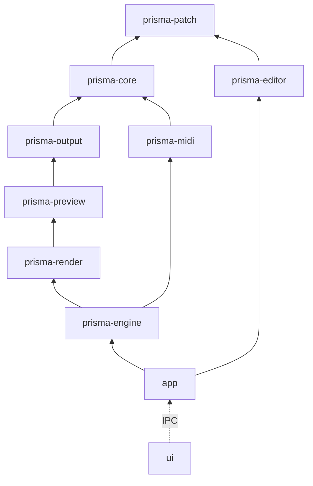
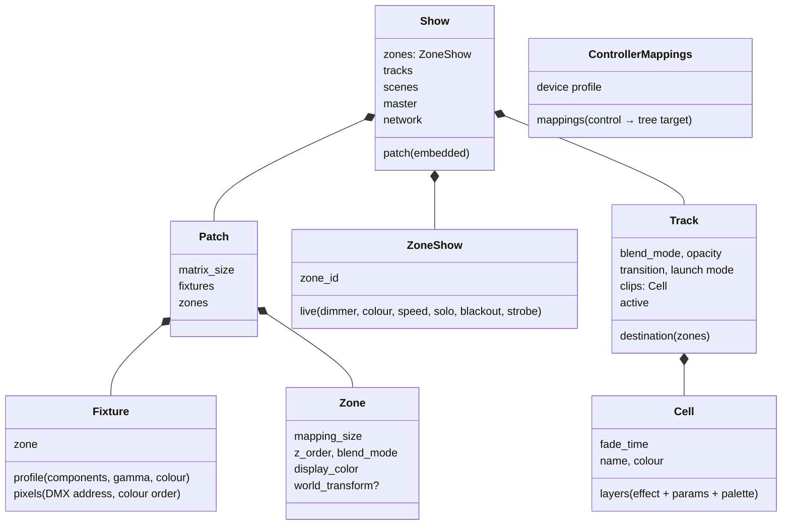
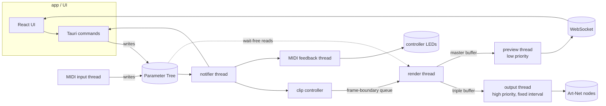
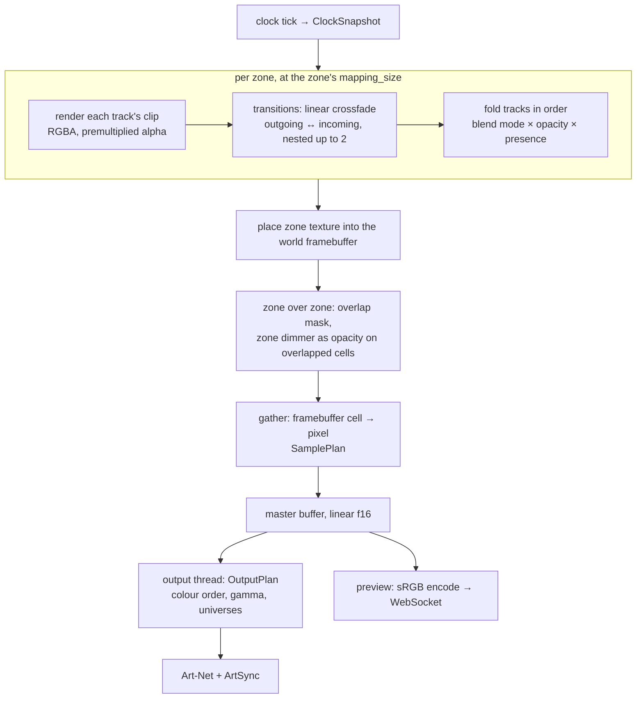
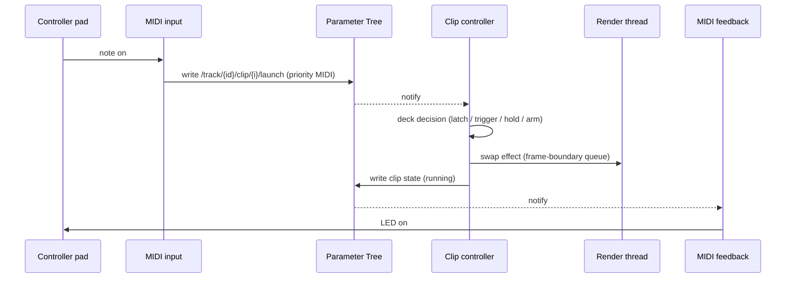

# Architecture

How Prisma is put together: crates, documents, threads, the path of a frame and the path of a
control. Detailed design decisions live in the doc comments of each module; this file is the map.

Scope: the live model with tracks. Zones, patch, output and preview are unchanged by it.

## 1. Crates

Arrows point to what a crate depends on. Dependencies implied by another arrow are left out
(`render` also uses `core`, `patch` and `output` directly).

| Crate | Owns |
|---|---|
| `prisma-patch` | patch model, `PatchIndex` |
| `prisma-core` | clock, Parameter Tree, show model, decks, transitions |
| `prisma-output` | `OutputPlan`, Art-Net, output scheduler, virtual sink |
| `prisma-preview` | master buffer → sRGB → WebSocket |
| `prisma-render` | wgpu, effects, blend, gather |
| `prisma-midi` | mappings, learn, device profiles, LED feedback |
| `prisma-editor` | patch draft, reversible edit ops |
| `prisma-engine` | assembly, threads, show content |
| `prisma-script` | Lua, placeholder |
| `app` | Tauri shell, IPC commands |
| `ui` | React |

Rules:

- `prisma-core` never depends on `prisma-render`. The model is testable without a GPU.
- `prisma-midi` depends on `prisma-core` only. MIDI writes the Parameter Tree and nothing else.
- `prisma-output` knows nothing about the preview or the renderer.
- `app` is not a workspace member: it needs the desktop toolchain. Everything below it builds and
  tests headless (software GPU: lavapipe).

## 2. Documents

Three files, each with a versioned envelope.

| Document | File | Belongs to | Holds |
|---|---|---|---|
| Patch | embedded in `.prisma`, or `.patch.json` | the rig | where every pixel is and how it is addressed. No performable state. |
| Show | `.prisma` | the show | zones' live state, tracks, clips, scenes, master, network nodes. |
| Controller mappings | profile file | the operator and their hardware | which physical control drives which tree path. Follows the operator across shows. |

Autosave writes the Show to the app data folder (`autosave.prisma`), never over the operator's file.

## 3. Threads

| Thread | Owner | Rule |
|---|---|---|
| render | `prisma-render::render_loop` | owns the clock tick. Never blocks: readback goes through a ring, a full ring skips the frame. |
| output | `prisma-output::scheduler` | absolute-deadline ticks, park + spin. Never waits on render: no fresh frame → resend the last one. |
| preview | `prisma-preview::preview_loop` | off the critical path. Under backpressure it drops frames. |
| notifier | `prisma-core::notify` | fans tree writes out to subscribers. A slow subscriber cannot stall writers. |
| clip controller | `prisma-engine::clips` | turns `/track/.../clip/...` writes into deck decisions and effect swaps. |
| MIDI in / feedback | `prisma-midi` | input writes the tree at MIDI priority; feedback paints LEDs from tree state. |

Structural changes (patch edits, adding/removing/reordering tracks, destination changes) do not go
through the tree. They rebuild the engine with `recompile_show`, which keeps the GPU device, the
clock, faders and BPM.

## 4. A frame

Notes:

- One track in `Normal` at full opacity skips the fold and renders straight into the zone texture.
  The two paths are tested to give the same frame.
- Zone dimmer, colour filter and master apply at the output stage, except on overlapped cells, where
  they must be applied before zones are combined.
- Everything GPU-sized is allocated at compile time. Nothing is allocated per frame.
- The master buffer is RGB: premultiplied alpha read over black. Output and preview do not see alpha.

## 5. A control

Pad on the controller launches a clip:

A mouse click takes the same path from `Tree` on: the Tauri command writes the same path at UI
priority. Keyboard, touch view and future OSC are the same: another writer into the tree.

## 6. Parameter Tree

Every controllable value has a path, a normalized `0..1` value and a curve to its real range. Reads
from the render and output threads are wait-free. Concurrent writers are resolved by priority with
takeover after idle.

| Path | Kind |
|---|---|
| `/master/dimmer`, `/master/blackout`, `/master/strobe/...` | level / toggle |
| `/clock/bpm`, `/clock/tap` | level / trigger |
| `/zone/{id}/dimmer`, `speed`, `solo`, `blackout`, `strobe/...` | level / toggle |
| `/track/{id}/clip/{i}/launch`, `trigger`, `hold` | trigger / toggle |
| `/track/{id}/clip/{i}/state` | read-only: empty, assigned, running, armed |
| `/track/{id}/opacity`, `mute`, `solo`, `stop` | level / toggle / trigger |
| `/track/{id}/layer/0/param/...` | effect parameters of the running clip |
| `/scene/{i}/launch` | trigger |
| `/arm/go`, `/arm/clear`, `/tracks/stop` | trigger |

Controller mappings address zones by slot (first zone, second zone…), so a profile keeps working
across shows.

## 7. Where things are

| Topic | File |
|---|---|
| Show model, tracks, cells | `crates/prisma-core/src/show/model.rs` |
| Launch / hold / arm logic | `crates/prisma-core/src/deck.rs` |
| Transitions | `crates/prisma-core/src/transition.rs` |
| Tree, arbitration, notification | `crates/prisma-core/src/{tree,arbitration,notify,slot}.rs` |
| Per-zone track compositor | `crates/prisma-engine/src/zone_content.rs` |
| Clips as tree targets | `crates/prisma-engine/src/clips.rs` |
| Engine assembly, recompile | `crates/prisma-engine/src/engine.rs` |
| Effects and their manifests | `crates/prisma-render/src/effects.rs`, `shaders/*.wgsl` |
| Blend modes | `shaders/blend.wgsl`, `crates/prisma-render/src/blend.rs` |
| Gather | `crates/prisma-render/src/sample.rs`, `shaders/sample.wgsl` |
| Wire plan, Art-Net, timing | `crates/prisma-output/src/{plan,packet,scheduler,frame}.rs` |
| MIDI | `crates/prisma-midi/src/{runtime,resolver,feedback,profile}.rs`, `profiles/` |
| Patch editor backend | `crates/prisma-editor/src/{draft,op}.rs` |
| IPC commands | `app/src/main.rs` |
| UI | `ui/src/` (`MainWindow`, `TrackGrid`, `ZoneRow`, `EffectParams`, `Editor`) |
| Design system | `docs/DESIGN.md`, `ui/src/theme.css` |
